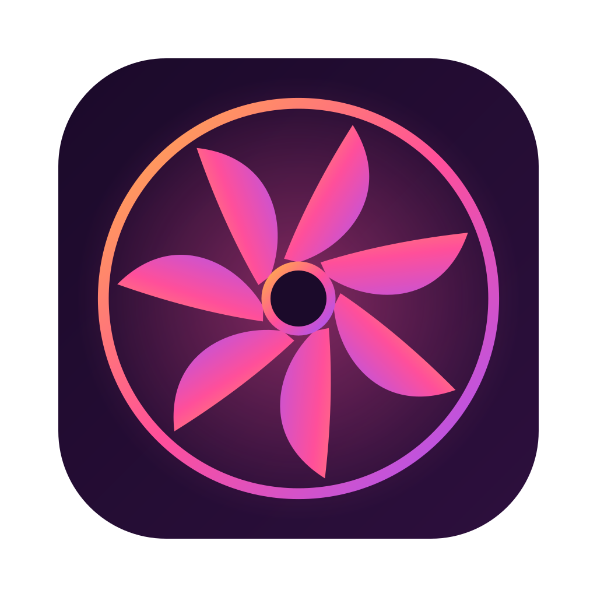

<p align="center"></p>

<h1 align="center">Turbine for Mac</h1>

Turbine for Mac is a native macOS app for **GTA VI over Xbox Remote Play**. It plays `play.xbox.com` with the [Turbine](https://github.com/rpatty-dev/turbine) keyboard and mouse controls built in. Every frame goes through **MetalFX upscaling** and **GPU frame generation** before it reaches your screen.

## How it works

1. A web view loads `play.xbox.com` with Turbine's controls injected, and the mouse is locked natively.
2. ScreenCaptureKit captures that window at roughly the stream's own resolution (1080p).
3. **MetalFX Spatial** upscales each frame to your display's native Retina resolution.
4. **Frame generation:** a Metal shader estimates motion between frames (block matching at quarter resolution), and the in-between frames are warped along that motion and shown on the display's refresh.
   - A 30 fps stream becomes 60 fps on a 60 Hz screen.
   - A 60 fps stream becomes 120 fps on ProMotion.
   - It turns itself off when your display isn't faster than the stream.

Apple's Vision optical flow was tested and dropped: it took about 20 ms per frame on an M2, which is too slow for 60 fps.

## Build and run

You need an Apple silicon Mac with macOS 14 or newer, and Xcode or the Command Line Tools.

```bash
./build.sh
open build/Turbine.app
```

On first launch, allow Turbine under System Settings → Privacy & Security → **Screen & System Audio Recording**, then reopen it. Without that permission, the stream still plays but without upscaling or frame generation.

## Controls

The game controls match [Turbine](https://github.com/rpatty-dev/turbine#controls). App keys:

| Key | Action |
|---|---|
| Click the video | Lock the mouse |
| Esc | Release the mouse |
| Cmd+F | Fullscreen on / off |
| F7 | Frame generation on / off |
| F10 | MetalFX upscaling on / off |
| F8 / F9 | Controller emulation / stats overlay |

## Limits

- **Not DLSS:** DLSS needs an NVIDIA GPU and data from the game engine. MetalFX Spatial is Apple's upscaler that works on plain video.
- **Capture delay:** window capture adds about 5–10 ms. Frame generation adds about half a stream frame, around 17 ms at 30 fps.
- **Artifacts:** generated frames can smear around the HUD and during very fast camera turns. Press F7 to compare.
- **Signing:** the app is ad-hoc signed. After each rebuild, macOS may ask for Screen Recording permission again.

Turbine isn't affiliated with or endorsed by Rockstar Games, Take-Two Interactive, Microsoft or Xbox.

## License

MIT
